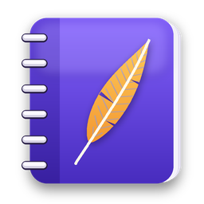

# NoteHawk

A free notes app for Windows from **Bytehawk Studio**, part of the Hawk suite. It works like Evernote and OneNote together: notebooks with OneNote-style section tabs and pages, an Evernote-style note list and Home dashboard, tags, tasks and search. It uses Bytehawk's Hawkline look (the same left sidebar as Guardrail EHS and WillowWallet).

> **Preview (0.1.0):** this is the shell. You can browse three sample notebooks and every screen; editing, saving, search, sync and the rest are marked **coming soon**.

## Run it

- **Installer:** `NoteHawk-<version>-Setup.exe` from Releases (or through the Bytehawk Studio Launcher).
- **From source:** install the [.NET 8 SDK](https://dotnet.microsoft.com/download/dotnet/8.0), then double-click `run.bat`.
- **Build the exe, zip and installer:** `.\build.ps1` (needs Inno Setup 6: `winget install JRSoftware.InnoSetup`).

## Planned

- Rich text editor: styles, fonts, lists, checklists, tables, images, attachments, code blocks, ink and audio
- Notebooks → sections → pages, section groups, notebook stacks
- Tasks and reminders inside notes, calendar and meeting notes
- Tags, templates, trash and page history
- Search, including text in images and PDFs
- Web clipper
- PIN/password lock with encrypted notes
- NoteHawk Server (self-hosted) for sync and sharing
- Import from Evernote (.enex) and OneNote

## Project layout

| Path | What |
|---|---|
| `src/NoteHawk.Desktop` | WPF (.NET 8) app |
| `src/NoteHawk.Desktop/Models/ModuleCatalog.cs` | every sidebar section and its planned features |
| `src/NoteHawk.Desktop/Models/SampleData.cs` | the sample notebooks shown in the preview |
| `tools/make_icon.py` | draws the app icon |
| `tools/make_icon_font.py` | builds the icon font from Fluent UI System Icons (MIT) |
| `installer/NoteHawk.iss` | Inno Setup installer |

Releasing: bump `<Version>` in the .csproj and push to `main`; CI builds, self-tests, test-installs and publishes the GitHub Release.

© 2026 Bytehawk Studio. MIT License.
